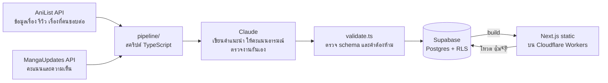

# อ่านอะไรดี.

เว็บแนะนำมังงะและมังฮวา **ตามอารมณ์ที่อยากรู้สึก** — อยากมันสะใจ อยากฟิน อยากร้องไห้ หรืออยากอ่านชิลๆ ก็เลือกได้ แต่ละเรื่องมีคำแนะนำภาษาไทยสไตล์เพื่อนป้ายยา คะแนนอารมณ์ 6 ด้านที่สรุปจากเสียงคนอ่านจริง และลิงก์ไปอ่านแบบถูกลิขสิทธิ์

**เว็บจริง:** https://review-manga.rockhome03.workers.dev


| หน้าเรื่อง | บนมือถือ |
|---|---|
|  |  |

## ทำอะไรได้บ้าง

- **เลือกตามอารมณ์** — กรองเรื่องตามอารมณ์ (มันส์ระเบิด, ฟินใจละลาย, ซึ้งกินใจ, ลุ้นระทึก, ฮาไม่ไหว, ชิลๆ) ประเภท และความยาว หรือกดสุ่มให้หนึ่งเรื่อง
- **คำแนะนำภาษาไทย 644 เรื่อง** — เปิดด้วยจุดขายของเรื่อง มีรายละเอียดที่ทำให้อยากอ่าน และบอกตรงๆ ว่าใครอาจไม่ชอบ
- **คะแนนอารมณ์พร้อมเหตุผล** — สรุปจากรีวิวใน AniList และความเห็นใน MangaUpdates (เขียนใหม่เป็นคำของเราเอง ไม่ยกข้อความรีวิวมา)
- **"ถ้าชอบเรื่องนี้"** — แนะนำต่อเรื่องละ 3 เรื่อง พร้อมบอกว่าเหมือนกันตรงไหน ต่างกันตรงไหน
- **โหวต 👍/👎 "ตรงไหม?"** — ให้คนอ่านบอกว่าคะแนนอารมณ์ตรงกับที่รู้สึกไหม (ตอนนี้เก็บโหวตไว้ ยังไม่มีเครื่องมือสรุปผล)
- **ลิสต์คัดสรร 10 ลิสต์** — เช่น กำลังฮิตตอนนี้, พระเอกเลเวลอัป ยิ่งอ่านยิ่งเทพ, เตรียมทิชชู่ให้พร้อม, จบสั้น อ่านรวดเดียว, มีลิขสิทธิ์ไทย แต่ละลิสต์มีหน้าของตัวเอง (`/list/<slug>`) ลิสต์ที่ผูกกับอารมณ์จะแสดงเหตุผลด้านอารมณ์ของแต่ละเรื่องด้วย
- **ลิงก์อ่านแบบถูกลิขสิทธิ์** — แอปและเว็บอ่านทางการทั้งภาษาไทยและอังกฤษ จากลิงก์ที่ AniList รวบรวมไว้ และฉบับรวมเล่มภาษาไทย (203 เรื่อง) ที่หาจาก Wikipedia ภาษาไทยผ่าน Wikidata ว่าออกกับสำนักพิมพ์ไหน ลิงก์ไปร้านทางการของสำนักพิมพ์ ส่วนสำนักพิมพ์ที่ยังไม่ได้ยืนยันร้าน จะลิงก์ไปหน้าวิกิพีเดียที่ระบุสำนักพิมพ์
- **ค้นหา เรียงลำดับ และเรื่องเด่นประจำสัปดาห์** (หมุนตาม AniList trending)

## สถาปัตยกรรม



- **เว็บเป็น static ทั้งหมด** — ทุกหน้า build จาก Supabase ตอน deploy คนเข้าเว็บไม่ได้ยิง database เลย (ยกเว้นตอนโหวต) เร็วและแทบไม่มีค่าใช้จ่าย
- **Deploy** — GitHub Actions build และ deploy ขึ้น Cloudflare Workers (ผ่าน OpenNext) ทุกครั้งที่ push และทุกวันจันทร์เพื่อหมุนเรื่องเด่นประจำสัปดาห์และลิสต์มาแรง

## การทำงานกับ AI ให้ได้คุณภาพ

เนื้อหาทั้งหมดเขียนโดย AI จากข้อมูลจริง เลยต้องมีระบบกันงานหลุด:

- **แยกคนเขียนกับคนตรวจ** — subagent สองตัวใน Claude Code: นักเขียน (`.claude/agents/manga-writer.md`) กับบรรณาธิการ (`.claude/agents/manga-reviewer.md`) ที่ตรวจเทียบข้อมูลต้นทางตามเกณฑ์ใน `pipeline/review-prompt.md` เรื่องที่ไม่ผ่านจะถูกส่งกลับไปเขียนใหม่พร้อมคำติ แล้วตรวจซ้ำ
- **ทดสอบแบบ blind** — ให้ Opus, Sonnet และ Haiku เขียน 20 เรื่องชุดเดียวกัน แล้วให้บรรณาธิการตรวจโดยไม่บอกว่าชิ้นไหนมาจากโมเดลไหน (`data/model-test/`) ผลนี้ใช้เลือกว่าแต่ละงานใช้โมเดลไหน
- **กฎที่ตรวจด้วยโค้ด** — schema (zod) บังคับรูปแบบข้อมูล และ `validate.ts` เตือนเมื่อคำแนะนำอ้างรีวิวหรือคนอ่าน ("รีวิวบอกว่า…") หรือใช้วลีต้องห้าม ให้คนตรวจก่อน import

Prompt ทั้งหมดอยู่ใน `pipeline/*.md`

**เส้นทางหลักคือ subagent ใน Claude Code** และมี **Claude Batch API** (`pipeline/batch.ts`) เป็นทางเลือก ตัวสคริปต์ใช้ prompt และ schema ชุดเดิม ครบทุกขั้น: Sonnet เขียน → Opus ตรวจ → เขียนใหม่ → ตรวจซ้ำ แล้วให้คะแนนอารมณ์ด้วย Haiku

ทดสอบจริงกับเรื่องใหม่ 50 เรื่อง แล้วให้ subagent ตรวจซ้ำอีกรอบโดยอิสระ:
- ค่าใช้จ่าย $1.60 หรือราว $0.03 ต่อเรื่อง
- subagent เจอปัญหา 13 เรื่อง batch จับได้ก่อนแล้ว 7 เรื่อง แต่หลุดไป 3 เรื่อง หนึ่งในนั้นคือประโยคที่แปลตามรีวิว
- ขั้นคะแนนอารมณ์ได้ป้ายตรงกับ Opus ที่ให้คะแนนแบบ blind 98% และใช้เงินแค่ $0.02

เนื้อหาที่ AI เขียนต้องมีคนหรือ subagent ตรวจก่อนขึ้นเว็บอยู่ดี batch จึงไม่ได้ช่วยให้ไม่ต้องมีคนคุม ส่วนที่ได้เปรียบจริงคือขยายเป็นครั้งละหลายร้อยเรื่องได้ ที่ขนาดปัจจุบัน (ครั้งละราว 50 เรื่อง) subagent ตรวจได้ละเอียดกว่าและไม่มีค่าใช้จ่ายเพิ่ม จึงใช้ batch เฉพาะขั้นคะแนนอารมณ์ และจะกลับมาใช้ batch เต็มรูปแบบเมื่อปริมาณงานโตจนเกินกำลังของ subagent

## รายละเอียดทางเทคนิคที่น่าสนใจ

- **กันสแปมโหวตใน database** — trigger ใน Postgres จำกัดหนึ่ง IP ต่อหนึ่งแถวต่อวัน และ 60 โหวตต่อชั่วโมง เก็บเป็น hash ของ salt ลับ + วันที่ + IP ไม่เก็บ IP จริง และ IP เดียวกันได้ hash คนละค่าในแต่ละวัน จึงตามรอยข้ามวันไม่ได้ (`supabase/migrations/0003_mood_votes.sql`)
- **Row Level Security** — คนทั่วไปอ่านได้เฉพาะเนื้อหาที่เผยแพร่แล้ว และเขียนได้แค่ตารางโหวต (insert อย่างเดียว อ่านกลับไม่ได้)
- **การเลือกเรื่องแนะนำต่อ** — ให้คะแนนจากโหวตของคนอ่าน AniList รวมกับความคล้ายของแท็ก แนว และอารมณ์ แล้วลงโทษลิงก์ที่วนกลับไปมาระหว่างสองเรื่อง (`pipeline/pick-recs.ts`)
- **SEO** — sitemap (705 URL), canonical URL, JSON-LD (ComicSeries, ItemList, BreadcrumbList ผ่าน Rich Results Test) ยืนยันกับ Google Search Console แล้ว และ Lighthouse ได้ SEO 100 ทั้งหน้าแรก หน้าเรื่อง และหน้าลิสต์

## Tech stack

Next.js 16 (App Router) · React 19 · Tailwind CSS 4 · TypeScript · Supabase (Postgres) · Cloudflare Workers + OpenNext · GitHub Actions · Claude API (Anthropic SDK) · Cloudflare Web Analytics

## โครงสร้าง repo

```
web/                 เว็บ Next.js
pipeline/            สคริปต์ดึงข้อมูล สร้างเนื้อหา ตรวจ และ import + prompt
supabase/migrations/ schema, RLS, trigger
data/generated/      คำแนะนำที่ AI เขียน (ผลลัพธ์)
data/moods/          คะแนนอารมณ์
data/rec-text/       ข้อความการ์ด "ถ้าชอบเรื่องนี้"
data/model-test/     ทดสอบเทียบโมเดลแบบ blind และผลทดสอบ Batch API
docs/screenshots/    ภาพหน้าจอ
```

ข้อมูลดิบจาก AniList และ MangaUpdates ไม่ได้อยู่ใน repo สาธารณะ เพราะมีข้อความรีวิวที่ผู้ใช้ของเว็บเหล่านั้นเขียน ผลตรวจของบรรณาธิการ AI ก็ไม่ได้อยู่ด้วยเหตุผลเดียวกัน (ยกท่อนรีวิวมาเทียบเวลาจับว่าประโยคไหนแปลตามรีวิว) ถ้าจะรันเอง สคริปต์ `pipeline/fetch-*.ts` ดึงข้อมูลชุดเดียวกันได้

## งานออกแบบ

ออกแบบหน้าตาเว็บเองก่อนเริ่มเขียนโค้ด แล้วนำมาทำจริงให้ใกล้ดีไซน์ที่สุด


## สถานะและแผนต่อไป

**เสร็จแล้ว**
- [x] เว็บขึ้นจริง 694 เรื่อง (มังงะญี่ปุ่นและมังฮวาเกาหลี)
- [x] คำแนะนำทุกเรื่องผ่านบรรณาธิการ AI (เขียน → ตรวจ → เขียนใหม่ → ตรวจซ้ำ) การ์ดแนะนำต่อผ่านการตรวจเกือบทุกชุด คะแนนอารมณ์ให้แยกจากคำแนะนำ และตรวจซ้ำบางชุด
- [x] Claude Batch API ครบทุกขั้น ทดสอบกับเรื่องจริง 50 เรื่อง (ใช้จริงเฉพาะคะแนนอารมณ์ ดูเหตุผลด้านบน)
- [x] โหวต 👍/👎 พร้อมกันสแปม และ Web Analytics
- [x] ลิงก์อ่านทางการภาษาไทยและอังกฤษ ฉบับรวมเล่มภาษาไทยพร้อมร้านของสำนักพิมพ์ และลิสต์ "มีลิขสิทธิ์ไทย"
- [x] ลิสต์คัดสรรสร้างจากกฎ (คะแนนอารมณ์ แท็ก สถานะ จำนวนตอน) บวกเรื่องที่เลือกใส่เอง ลิสต์กำลังฮิตอัปเดตจาก AniList ทุกสัปดาห์ + หน้าลิสต์ที่ Google index ได้ + Search Console

**กำลังทำ**
- [ ] ร้านทางการของสำนักพิมพ์ที่เหลือ (ตอนนี้มีสยามอินเตอร์ รักพิมพ์ ฟีนิกซ์) และลิงก์ตรงไปหน้าซีรีส์ในร้าน
- [ ] สรุปผลโหวต 👍/👎 เพื่อชี้ว่าคะแนนอารมณ์เรื่องไหนควรกลับไปตรวจ
- [ ] หน้าตามอารมณ์ (`/mood/...`) ให้ Google index ได้
- [ ] ปรับรูปปกให้เบาลงบนมือถือ

## เครดิต

ข้อมูลเรื่องจาก [AniList](https://anilist.co) · ความเห็นคนอ่านจาก [MangaUpdates](https://www.mangaupdates.com) · ภาพปกเป็นลิขสิทธิ์ของเจ้าของผลงาน
