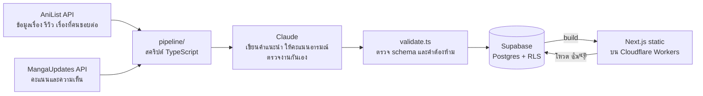

# อ่านอะไรดี.

เว็บแนะนำมังงะและมังฮวา **ตามอารมณ์ที่อยากรู้สึก** — อยากมันสะใจ อยากฟิน อยากร้องไห้ หรืออยากอ่านชิลๆ ก็เลือกได้ แต่ละเรื่องมีคำแนะนำภาษาไทยสไตล์เพื่อนป้ายยา คะแนนอารมณ์ 6 ด้านที่สรุปจากเสียงคนอ่านจริง และลิงก์ไปอ่านแบบถูกลิขสิทธิ์

**เว็บจริง:** https://review-manga.rockhome03.workers.dev


| หน้าเรื่อง | บนมือถือ |
|---|---|
|  |  |

## ทำอะไรได้บ้าง

- **เลือกตามอารมณ์** — กรองเรื่องตามอารมณ์ (มันส์ระเบิด, ฟินใจละลาย, ซึ้งกินใจ, ลุ้นระทึก, ฮาไม่ไหว, ชิลๆ) ประเภท และความยาว หรือกดสุ่มให้หนึ่งเรื่อง
- **คำแนะนำภาษาไทย 484 เรื่อง** — เปิดด้วยจุดขายของเรื่อง มีรายละเอียดที่ทำให้อยากอ่าน และบอกตรงๆ ว่าใครอาจไม่ชอบ
- **คะแนนอารมณ์พร้อมเหตุผล** — สรุปจากรีวิวใน AniList และความเห็นใน MangaUpdates (เขียนใหม่เป็นคำของเราเอง ไม่ยกข้อความรีวิวมา)
- **"ถ้าชอบเรื่องนี้"** — แนะนำต่อเรื่องละ 3 เรื่อง พร้อมบอกว่าเหมือนกันตรงไหน ต่างกันตรงไหน
- **โหวต 👍/👎 "ตรงไหม?"** — ให้คนอ่านบอกว่าคะแนนอารมณ์ตรงกับที่รู้สึกไหม ใช้ชี้ว่าควรกลับไปตรวจเรื่องไหน
- **ค้นหา เรียงลำดับ เรื่องเด่นประจำสัปดาห์ และลิสต์คัดสรร**

## สถาปัตยกรรม



- **เว็บเป็น static ทั้งหมด** — ทุกหน้า build จาก Supabase ตอน deploy คนเข้าเว็บไม่ได้ยิง database เลย (ยกเว้นตอนโหวต) เร็วและแทบไม่มีค่าใช้จ่าย
- **Deploy** — GitHub Actions build และ deploy ขึ้น Cloudflare Workers (ผ่าน OpenNext) ทุกครั้งที่ push และทุกวันจันทร์เพื่อหมุนเรื่องเด่นประจำสัปดาห์

## การทำงานกับ AI ให้ได้คุณภาพ

เนื้อหาทั้งหมดเขียนโดย AI จากข้อมูลจริง เลยต้องมีระบบกันงานหลุด:

- **แบ่งหน้าที่ตามโมเดล** — Sonnet เขียนคำแนะนำ, Opus เป็นบรรณาธิการตรวจ, Haiku ให้คะแนนอารมณ์ เรื่องที่ไม่ผ่านจะถูกส่งกลับไปเขียนใหม่พร้อมคำติ แล้วตรวจซ้ำ
- **ทดสอบแบบ blind** — เทียบผลจากหลายโมเดลโดยไม่บอกว่าชิ้นไหนมาจากโมเดลไหน ก่อนเลือกว่าจะใช้โมเดลไหนกับงานไหน
- **กฎที่ตรวจด้วยโค้ด** — `validate.ts` บล็อกคำแนะนำที่ยกรีวิวมาอ้าง ใช้วลีต้องห้าม หรือแนะนำเรื่องที่ไม่อยู่ในรายการที่คนอ่านชอบต่อจริง
- **ฟังคนอ่านจริง** — ปุ่มโหวตบนเว็บเป็นตัวชี้ว่าคะแนนไหนควรกลับไปดู

Prompt ทั้งหมดอยู่ใน `pipeline/*.md`

## รายละเอียดทางเทคนิคที่น่าสนใจ

- **กันสแปมโหวตใน database** — trigger ใน Postgres จำกัดหนึ่ง IP ต่อหนึ่งแถวต่อวัน และ 60 โหวตต่อชั่วโมง เก็บ IP เป็น hash ที่เปลี่ยน salt ทุกวัน ไม่เก็บ IP จริง (`supabase/migrations/0003_mood_votes.sql`)
- **Row Level Security** — คนทั่วไปอ่านได้เฉพาะเนื้อหาที่เผยแพร่แล้ว และเขียนได้แค่ตารางโหวต (insert อย่างเดียว อ่านกลับไม่ได้)
- **การเลือกเรื่องแนะนำต่อ** — ให้คะแนนจากโหวตของคนอ่าน AniList รวมกับความคล้ายของแท็ก แนว และอารมณ์ แล้วลงโทษลิงก์ที่วนกลับไปมาระหว่างสองเรื่อง (`pipeline/pick-recs.ts`)
- **SEO** — sitemap, canonical URL, JSON-LD และ Lighthouse ได้ Accessibility / Best Practices / SEO 100 ทั้งหน้าแรกและหน้าเรื่อง

## Tech stack

Next.js 16 (App Router) · React 19 · Tailwind CSS 4 · TypeScript · Supabase (Postgres) · Cloudflare Workers + OpenNext · GitHub Actions · Claude API (Anthropic SDK) · Cloudflare Web Analytics

## โครงสร้าง repo

```
web/                 เว็บ Next.js
pipeline/            สคริปต์ดึงข้อมูล สร้างเนื้อหา ตรวจ และ import + prompt
supabase/migrations/ schema, RLS, trigger
data/generated/      คำแนะนำที่ AI เขียน (ผลลัพธ์)
data/moods/          คะแนนอารมณ์
data/rec-text/       ข้อความการ์ด "ถ้าชอบเรื่องนี้"
data/reviews/        ผลตรวจของบรรณาธิการ AI
docs/screenshots/    ภาพหน้าจอ
```

ข้อมูลดิบจาก AniList และ MangaUpdates ไม่ได้อยู่ใน repo สาธารณะ เพราะมีข้อความรีวิวที่ผู้ใช้ของเว็บเหล่านั้นเขียน ถ้าจะรันเอง สคริปต์ `pipeline/fetch-*.ts` ดึงข้อมูลชุดเดียวกันได้

## งานออกแบบ

ออกแบบหน้าตาเว็บเองก่อนเริ่มเขียนโค้ด แล้วนำมาทำจริงให้ใกล้ดีไซน์ที่สุด


## สถานะและแผนต่อไป

**เสร็จแล้ว**
- [x] เว็บขึ้นจริง 484 เรื่อง (มังงะญี่ปุ่นและมังฮวาเกาหลี)
- [x] คำแนะนำ คะแนนอารมณ์ และการ์ดแนะนำต่อ ผ่านการตรวจหลายรอบ
- [x] โหวต 👍/👎 พร้อมกันสแปม และ Web Analytics

**กำลังทำ**
- [ ] ลิงก์ฉบับภาษาไทย — หาว่าเรื่องไหนมีฉบับพิมพ์ไทยจากสำนักพิมพ์ไหน (ใช้ Wikipedia ภาษาไทยผ่าน Wikidata) แล้วลิงก์ไปร้านทางการของสำนักพิมพ์และร้าน e-book
- [ ] อัปเดตอัตโนมัติรายสัปดาห์ด้วย Claude Batch API — ดึงเรื่องใหม่ เขียน ตรวจ และ import เอง
- [ ] ปรับรูปปกให้เบาลงบนมือถือ

## เครดิต

ข้อมูลเรื่องจาก [AniList](https://anilist.co) · ความเห็นคนอ่านจาก [MangaUpdates](https://www.mangaupdates.com) · ภาพปกเป็นลิขสิทธิ์ของเจ้าของผลงาน
